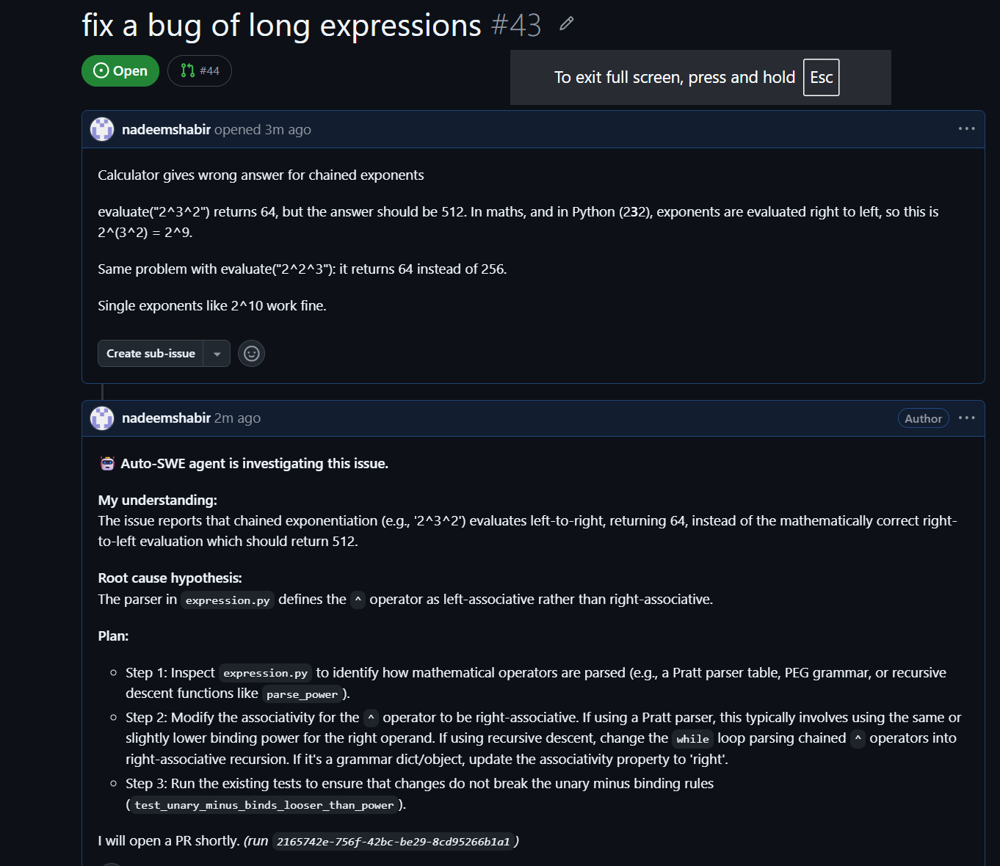
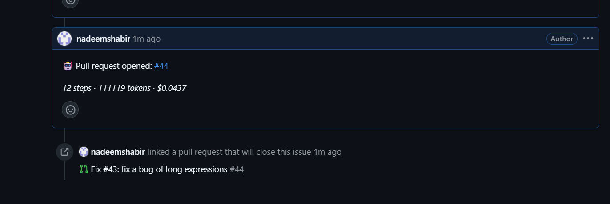
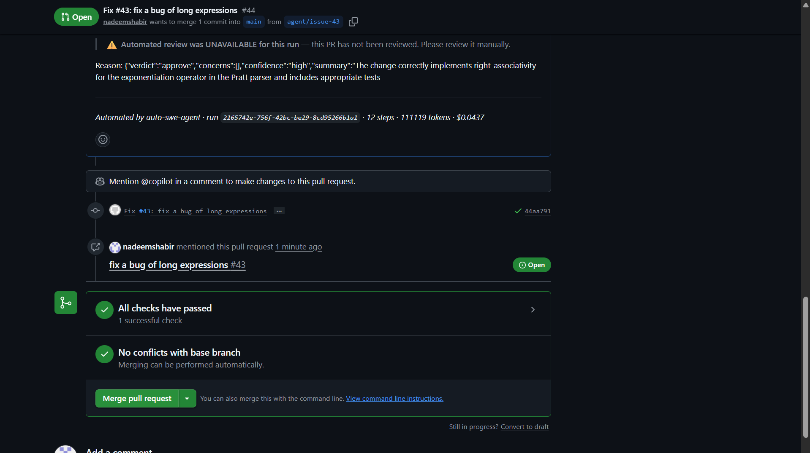
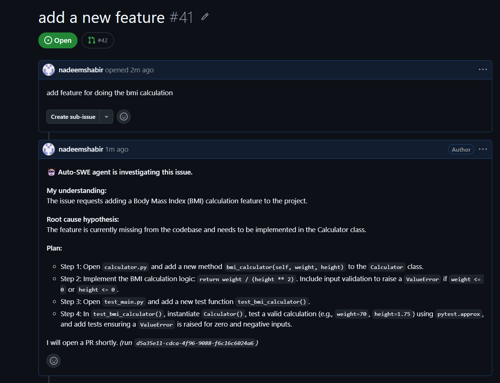
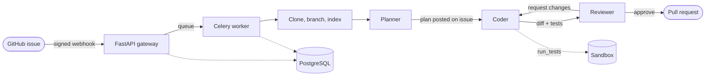
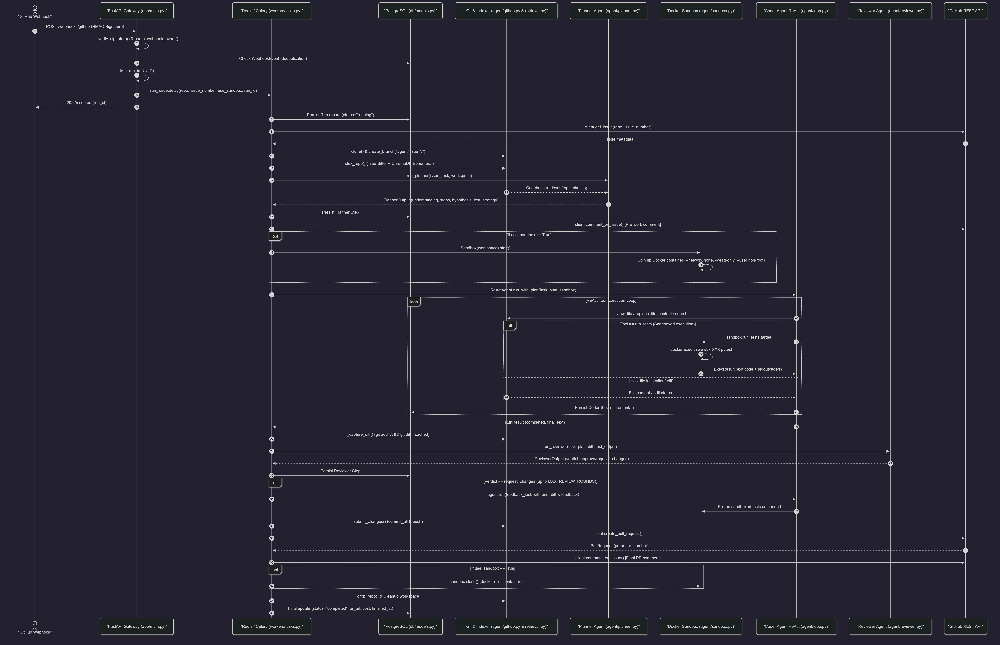
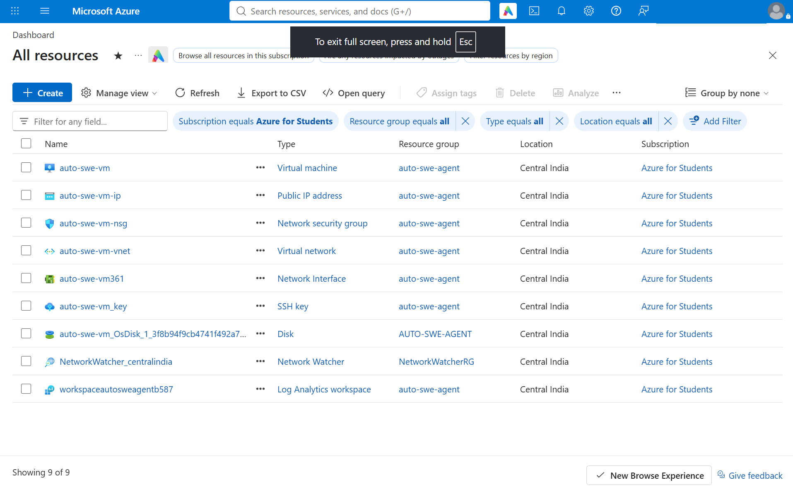

<div align="center">

# Auto-SWE Agent

### Open a GitHub issue. Get a pull request back.

A self-hosted AI software engineer for Python repositories. It reads the issue,
finds the code that matters, writes a fix with tests, gets it reviewed by a second
model, and opens a pull request that explains itself.

<p>
  <a href="LICENSE"></a>
  
  
  
  
  
  
</p>

<p>
  <a href="#see-it-work"><b>Demo</b></a> ·
  <a href="#how-it-works"><b>How it works</b></a> ·
  <a href="#features"><b>Features</b></a> ·
  <a href="#quick-start"><b>Quick start</b></a> ·
  <a href="#the-sandbox"><b>Sandbox</b></a> ·
  <a href="docs/how-it-works.md"><b>Deep dive</b></a>
</p>

</div>

---

## See it work

A real bug in a real expression parser: `2^3^2` returned **64** instead of **512**,
because the parser treated `^` as left-associative. Nobody pointed the agent at the
cause. It worked it out from the symptom.

<table>
  <tr>
    <td width="50%" valign="top">
      <b>1. The Planner diagnoses it.</b><br>
      Seconds after the issue is filed, it names the file and the root cause:
      the operator's associativity in the Pratt parser.<br><br>
      
    </td>
    <td width="50%" valign="top">
      <b>2. The Coder fixes it and opens a PR.</b><br>
      Edits, runs the tests, iterates until green, then reports what the run cost.<br><br>
      
      <br><br>
      <b>3. Merge-ready.</b> One commit, checks passing.<br>
      <b>12 steps · 111k tokens · $0.04</b>
    </td>
  </tr>
</table>

<p align="center">
  
</p>

> On this run the Reviewer's reply couldn't be parsed. Instead of quietly passing
> the change, the agent opened the PR with a visible *"review unavailable, please
> review manually"* banner. A missing review is never presented as a passed one.

<details>
<summary><b>It handles feature requests too</b> (click to expand)</summary>
<br>

</details>

---

## How it works



| Stage | What happens |
|---|---|
| **Gateway** | Verifies the HMAC signature, drops duplicate deliveries, checks the repo allowlist, queues the run, replies `202` |
| **Worker** | Clones the repo, creates `agent/issue-N`, indexes every Python file for semantic search |
| **Planner** | Reads the issue and the relevant code; posts its understanding, root-cause hypothesis and plan on the issue |
| **Coder** | A tool-using loop (search, read, edit, run tests) that iterates until the tests pass or the budget runs out |
| **Reviewer** | Reads the diff and test output like a senior engineer; can send it back with feedback, up to 2 rounds |
| **Ship** | Commits, pushes, opens a PR with before/after test evidence, links it to the issue, cleans up |

Every plan, tool call, test result and review is written to Postgres as it happens,
so you can follow a run live at `GET /runs/{id}/steps`.

**[Read the full walkthrough →](docs/how-it-works.md)**

<details>
<summary><b>Full sequence diagram</b></summary>
<br>

</details>

---

## Features

<table>
  <tr>
    <td width="50%" valign="top">
      <h4>Understands the codebase</h4>
      Every function, class and import is parsed with tree-sitter and embedded
      locally, so the agents retrieve the code that matters instead of guessing.
    </td>
    <td width="50%" valign="top">
      <h4>Three agents, three jobs</h4>
      Planner, Coder and Reviewer each get their own model. Plan and review with a
      strong one; run the expensive coding loop on a cheap one.
    </td>
  </tr>
  <tr>
    <td valign="top">
      <h4>Claude or Gemini</h4>
      Pick the provider and model per role in <code>.env</code>. Adding another
      provider means implementing one small interface.
    </td>
    <td valign="top">
      <h4>Hard cost limits</h4>
      One budget (dollars, tokens, steps, wall-clock time) is shared by all three
      agents. When it runs out, the run stops cleanly.
    </td>
  </tr>
  <tr>
    <td valign="top">
      <h4>Survives provider failures</h4>
      The Planner falls back to a stable model if the configured one is unusable;
      the Coder survives a provider outage mid-run.
    </td>
    <td valign="top">
      <h4>Safe to point at GitHub</h4>
      Signed webhooks, a repo allowlist, a token-protected manual trigger that is
      off until configured, rate limiting, and de-duplication so a retried webhook
      never opens two PRs.
    </td>
  </tr>
  <tr>
    <td valign="top">
      <h4>Full audit trail</h4>
      Every run and every step is stored and readable over a small REST API.
    </td>
    <td valign="top">
      <h4>Optional sandbox</h4>
      Run tests from code you don't trust in a locked-down, network-less
      container. <a href="#the-sandbox">More below.</a>
    </td>
  </tr>
</table>

---

## Quick start

**You need:** Docker with Compose, a GitHub token, and a Gemini or Anthropic API key.

**1. Configure**

```bash
git clone https://github.com/nadeemshabir/auto-swe-agent.git
cd auto-swe-agent
cp .env.example .env        # then fill it in
```

| Variable | What it is |
|---|---|
| `GEMINI_API_KEY` or `ANTHROPIC_API_KEY` | Your LLM key; set `LLM_PROVIDER` to match |
| `GITHUB_TOKEN` | Reads issues, pushes branches, opens PRs. Needs write access to contents, pull requests and issues |
| `GITHUB_WEBHOOK_SECRET` | Any random string; GitHub signs every delivery with it |
| `AGENT_REPO_ALLOWLIST` | The `owner/name` repos the agent may touch, comma-separated |
| `AGENT_API_TOKEN` | Protects the manual trigger endpoint |

**2. Start the stack**

```bash
docker compose up --build -d
curl localhost:8000/readyz      # {"status":"ready","redis":"ok","db":"ok","sandbox":"off"}
```

The first build takes a few minutes; it downloads a small embedding model.

**3. Connect GitHub**

```bash
ngrok http 8000                 # gives you https://<id>.ngrok-free.app

bash scripts/setup_webhook.sh --repo owner/name --url https://<id>.ngrok-free.app
bash scripts/setup_webhook.sh --repo owner/name --ping     # expect 204
```

The script creates the webhook for you. Re-run it after an ngrok restart and it
updates the existing hook rather than adding another. It also takes `--list` and
`--delete`.

**4. Open an issue** on an allowlisted repo, or label an existing one. The plan
appears as a comment within seconds, and the PR follows.

<details>
<summary><b>Trigger a run without webhooks</b></summary>

```bash
curl -X POST localhost:8000/runs \
  -H "X-Agent-Token: $AGENT_API_TOKEN" -H "Content-Type: application/json" \
  -d '{"repo": "owner/name", "issue_number": 42}'
```

Add `"use_sandbox": true` to the body to run just this one in the sandbox.
</details>

<details>
<summary><b>Watch a run</b></summary>

```bash
docker compose logs -f worker              # live
curl localhost:8000/runs                   # recent runs
curl localhost:8000/runs/<run_id>          # status, PR link, cost
curl localhost:8000/runs/<run_id>/steps    # every plan, tool call and review
```
</details>

<details>
<summary><b>Configuration reference</b></summary>
<br>

| Variable | Default | Effect |
|---|---|---|
| `PLANNER_MODEL` · `CODER_MODEL` · `REVIEWER_MODEL` | `LLM_MODEL` | Model per agent; `*_PROVIDER` picks the provider per agent |
| `MAX_USD` | `5.0` | Spend cap per run, shared by all three agents |
| `MAX_TOTAL_TOKENS` | `500000` | Token cap per run |
| `MAX_STEPS` | `30` | Cap on Coder model calls |
| `MAX_WALLCLOCK_S` | `1800` | Time limit per run, in seconds |
| `COMMENT_ON_START` | `true` | Post the plan on the issue before coding |
| `USE_SANDBOX` | `false` | Run tests in the sandbox |

Settings are read once at startup. After editing `.env`, run
`docker compose up -d --force-recreate api worker`.
</details>

---

## The sandbox

By default, the target repo's tests run inside the worker container. That's fine
for your own code. For code you didn't write, turn on the sandbox: every test run
then happens in a throwaway container where

| | |
|---|---|
| **No network** | Tests can't send your tokens anywhere |
| **Read-only filesystem** | Only a small `/tmp` is writable |
| **Not root** | All Linux capabilities dropped, no privilege escalation |
| **Resource limits** | CPU, memory and process caps |
| **`.git` hidden** | Test code can't plant git hooks that would run outside the sandbox |

```bash
bash docker/build-sandbox.sh      # builds auto-swe-sandbox:latest
# in .env: USE_SANDBOX=true
docker compose up -d --force-recreate api worker
curl localhost:8000/readyz        # ... "sandbox":"on"
```

> **Note:** with no network the sandbox can't install anything, so add the target
> repo's test dependencies to [`docker/sandbox.Dockerfile`](docker/sandbox.Dockerfile).
> On an ARM host, also switch the Docker CLI download in
> [`docker/worker.Dockerfile`](docker/worker.Dockerfile) from x86_64 to aarch64.

Details: [docs/sandbox.md](docs/sandbox.md)

---

## Deploy it

The same Compose stack runs on one small cloud VM, with Caddy in front for
automatic HTTPS. The reference deployment is an Azure B2pls_v2 (2 vCPU, 4 GB,
ARM) for about **$16 a month**.

<p align="center">
  
</p>

[docs/deployment.md](docs/deployment.md) covers the setup, why a VM rather than a
container platform, and every problem hit along the way.

---

## Project layout

```
app/        FastAPI gateway: webhooks, manual trigger, read API
workers/    Celery task that runs the whole pipeline for one issue
agent/      planner, loop (Coder), reviewer, retrieval, sandbox, GitHub, LLM providers
db/         SQLAlchemy models and Alembic migrations
docker/     api, worker and sandbox images
scripts/    webhook setup, Postgres setup, provider smoke test
tests/      integration tests (no API keys needed)
eval/       retrieval probes
docs/       design docs for every component
```

**Run the tests:**

```bash
pip install -r requirements.txt
python -m pytest tests/ -v        # 59 tests, no API key needed
```

---

## Limitations and roadmap

- **Python repositories only.** Retrieval parses Python; other languages index to
  nothing, so the agent would work without code context.
- **The sandbox needs the target repo's dependencies** baked into its image.
- **No end-to-end benchmark yet.** Retrieval has measured weak spots, and an
  evaluation harness that tracks fix rate is the top roadmap item.

Full roadmap, with the measurements behind its ordering:
[docs/future-goals.md](docs/future-goals.md)

---

## Documentation

| Doc | Covers |
|---|---|
| **[how-it-works.md](docs/how-it-works.md)** | **Start here.** The whole system end to end, and why it is built this way |
| [workflow_webhook_to_pr.md](docs/workflow_webhook_to_pr.md) | Every stage of a run, with code references |
| [retrieval.md](docs/retrieval.md) | Codebase indexing and search |
| [loop.md](docs/loop.md) | The Coder's tool-using loop |
| [github.md](docs/github.md) | Issue intake, branches, PRs |
| [sandbox.md](docs/sandbox.md) | The execution sandbox |
| [persistence.md](docs/persistence.md) | Database schema and idempotency |
| [llm-provider-abstraction.md](docs/llm-provider-abstraction.md) | Pluggable Claude/Gemini providers |
| [deployment.md](docs/deployment.md) | Running it on a server |
| [future-goals.md](docs/future-goals.md) | The roadmap |

---

## Contributing

Issues and pull requests are welcome. Run the test suite before opening a PR, and
for anything larger than a small fix, open an issue first so we can agree on the
approach.

## License

[MIT](LICENSE) © 2026 Nadeem Shabir Mir

<div align="center">
<br>
<sub>Built by Nadeem, a final-year B.Tech student at IIT Bombay, looking for a
full-time role in ML/AI engineering.</sub>
</div>
