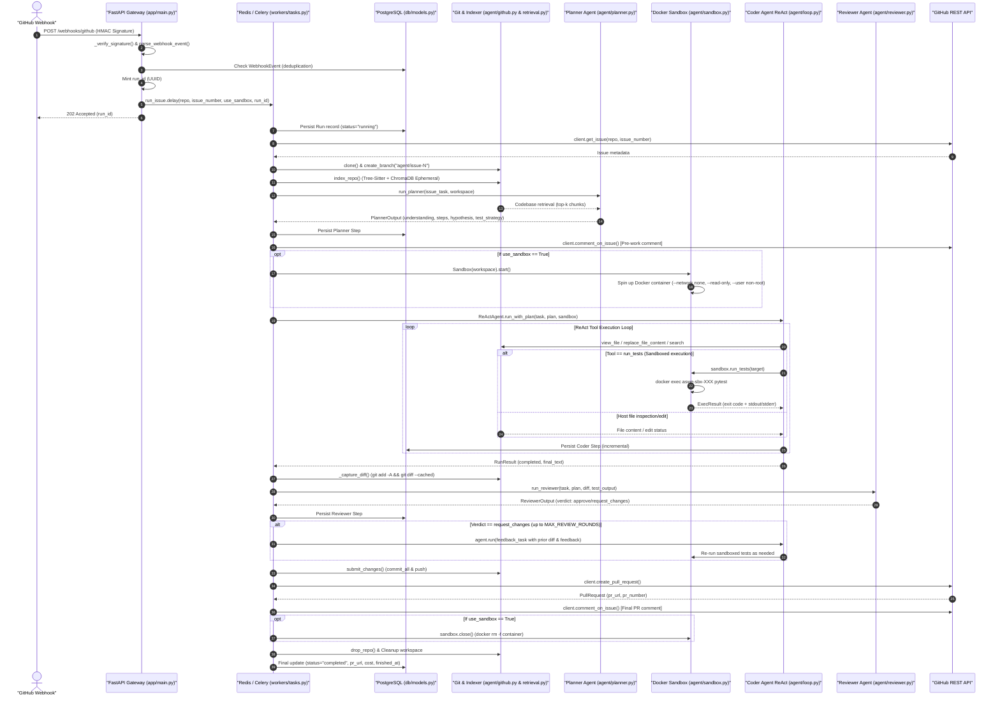

# Autonomous SWE Agent

**Open a GitHub issue. Get a pull request back. No human in the middle.**

This is an AI system that watches a repository, reads new issues, figures out
what the code actually does, writes a fix, runs the tests, and opens a PR
explaining itself — end to end, unattended.

It has been live on an Azure VM since 2026-08-03.

---

## The 60-second version

You file an issue:

> **Title:** `paginate() drops the last item on the final page`
> **Body:** When total items is an exact multiple of page_size we get an empty trailing page.

Roughly 90 seconds later, three things have happened without anyone touching a keyboard:

1. A comment appears on your issue explaining what the agent thinks is wrong and how it plans to fix it.
2. A branch `agent/issue-42` is pushed.
3. A PR opens, with a failing-test-then-passing-test writeup and a diff.

What happened in between:

| Stage | What it does |
|---|---|
| **Gateway** | Verifies the webhook's HMAC signature, de-duplicates it, mints a `run_id`, returns `202` immediately |
| **Worker** | Clones the repo into a throwaway workspace, cuts a branch, indexes every Python file into a vector store |
| **Planner** | Reads the issue + retrieved code, writes a hypothesis, a step list, and a test strategy |
| **Coder** | A ReAct loop — search, read, edit, run tests, observe, repeat — until the tests go green |
| **Reviewer** | Reads the final diff like a senior engineer would and returns approve / request-changes |
| **Back to Coder** | On request-changes, the feedback goes back into the loop (up to 2 rounds) |
| **Ship** | Commit, push, open the PR, comment on the issue, tear down the workspace |

Every step of that is written to Postgres as it happens, so you can watch a run
unfold at `GET /runs/{id}/steps` instead of guessing from logs.

---

## Why this was interesting to build

Most "AI writes code" demos work because the code fits in the prompt. This one
doesn't get that luxury — it's pointed at real repositories, so nearly every
hard part is about **what to show the model and what to do when it's wrong**:

- **It can't see the codebase.** So there's a retrieval layer: tree-sitter parses
  files into semantic chunks (one per function, method, class header, import),
  a local embedding model turns those into vectors, and a token-budgeted
  assembler packs the best ones into the prompt.
- **It runs code it has never seen.** So there's a hardened Docker sandbox —
  no network, read-only host filesystem, non-root, CPU and wall-clock capped.
- **It can spend real money.** So one budget object is shared across all three
  agents. When it's exhausted, the run stops cleanly rather than quietly costing $40.
- **Providers fall over.** The Planner falls back to a stable model when the
  configured one is unusable, and the Coder survives a mid-run provider outage
  instead of losing everything.
- **Webhooks fire twice.** So delivery IDs are de-duplicated and `(repo, issue_number)`
  is guarded — GitHub retrying doesn't get you two PRs.

The reasoning core isn't wired to one vendor. All three agents talk to an
`LLMProvider` interface and you pick provider *and* model per role.

---

## Architecture

Six layers, each testable on its own:

```
GitHub  ──▶  FastAPI gateway  ──▶  Redis/Celery  ──▶  Planner ─▶ Coder ─▶ Reviewer
                    │                                     │
                    ▼                                     ▼
               PostgreSQL                          Docker sandbox
            (runs, steps, events)                 (tests run in here)
```

<details>
<summary><b>Full webhook-to-PR sequence diagram</b> (click to expand)</summary>



</details>

### The Coder's toolbox

The ReAct loop gets five tools, all scoped to the workspace and path-traversal guarded:

| Tool | What it does |
|---|---|
| `retrieve_context` | Semantic search over the indexed repo. The starting point for every run. |
| `read_file` | Exact file contents. Required before editing. |
| `edit_file` | Unique-string replacement, or file creation. |
| `run_tests` | pytest — inside the sandbox when it's enabled, on the host otherwise. |
| `list_dir` | Directory listing, junk folders filtered. |

---

## Quick start

```bash
# 1. Configure
#    Required: GITHUB_TOKEN, GITHUB_WEBHOOK_SECRET, AGENT_API_TOKEN,
#              AGENT_REPO_ALLOWLIST, and GEMINI_API_KEY or ANTHROPIC_API_KEY
$EDITOR .env

# 2. Bring up the stack — API, worker, Redis, Postgres, migrations
docker compose up --build -d
curl localhost:8000/readyz          # {"status":"ready", ..., "sandbox":"off"}

# 3. Expose the gateway to GitHub
ngrok http 8000

# 4. Register the webhook — one command, no clicking through repo settings
bash scripts/setup_webhook.sh --repo owner/name --url https://<id>.ngrok-free.app
bash scripts/setup_webhook.sh --repo owner/name --ping     # expect 204

# 5. Open an issue and watch.
```

`setup_webhook.sh` is idempotent **by webhook path**, so re-running it after an
ngrok restart updates the existing hook instead of piling up dead ones. It also
takes `--list`, `--ping` and `--delete`.

### Running it directly, no GitHub involved

```bash
pip install -r requirements.txt
python -m agent.loop "Fix the off-by-one in paginate()" \
    --workspace /path/to/repo --auto-index
```

Budgets come from `--max-steps` / `--max-usd`; the model comes from env.

### Configuration worth knowing about

Each agent picks its own provider and model. Resolution goes role-specific vars →
`LLM_*` → a hardcoded default that **can never be empty**:

```bash
PLANNER_MODEL=gemini-3.1-pro-preview     # one call per run — plan quality sets everything downstream
CODER_MODEL=gemini-3.5-flash             # the ReAct loop; dominates token spend, so run it cheap
REVIEWER_MODEL=gemini-3.1-pro-preview    # one call per run — catching what the Coder missed
```

A model id is provider-specific and is never inherited across providers: setting
`PLANNER_PROVIDER=anthropic` while `LLM_PROVIDER=gemini` falls through to the
Anthropic default rather than handing a Gemini model name to the Anthropic API.

```bash
USE_SANDBOX=false            # run tests in the hardened container (needs a Docker daemon)
AGENT_REPO_ALLOWLIST=...     # repos the agent may touch — enforced on webhook AND POST /runs
MAX_USD=5.0                  # per-run spend cap, shared across all three agents
MAX_STEPS=30                 # cap on Coder model calls
MAX_REVIEW_ROUNDS=2          # Reviewer → Coder feedback rounds
```

⚠️ These are read **once at process start**. After editing `.env`:
`docker compose up -d --force-recreate api worker`.

---

## Where things stand

| Component | Status | Notes |
|---|---|---|
| Codebase understanding (`agent/retrieval.py`) | ✅ Done | tree-sitter chunking, embeddings, in-memory ChromaDB, token-budgeted context |
| Multi-agent reasoning (`planner.py`, `loop.py`, `reviewer.py`) | ✅ Done | one shared token/USD budget across all three, per-role model selection |
| GitHub integration (`agent/github.py`) | ✅ Done | rate-limit backoff, HMAC verification, idempotent PR creation |
| Backend & queue (`app/`, `workers/`, `db/`) | ✅ Done | FastAPI, Celery, Redis, Postgres + Alembic, append-only run history |
| Security | ✅ Done | HMAC webhooks, authenticated `POST /runs` (fail-closed), repo allowlist, rate limiting, TLS via Caddy |
| Cloud deployment | ✅ Done | single Azure VM, same Compose stack, Let's Encrypt, auto-shutdown |
| Docker sandbox (`agent/sandbox.py`) | ⚙️ Built, **off** | `USE_SANDBOX=false` in deployment — a config flip, not a code change |
| Observability (`monitoring/`) | ⏳ Not started | `/runs/{id}/steps` covers most of the need today |
| Eval harness (`eval/`) | ⏳ Not started | **the most important gap — see below** |

### Testing

```bash
python -m pytest tests/ -v    # 50 integration tests, no API key needed
python -m agent.loop          # per-module self-tests (also: planner, reviewer,
                              # github, sandbox, schemas, db.models, workers.tasks, app.main)
```

Every test was confirmed to **fail** against the pre-fix code before being
accepted — a test that passes either way proves nothing.

---

## Where this goes next

Honest read: the plumbing is solid and the retrieval layer is the weakest link.
Below is what I'd actually build, roughly in order of value-per-day-of-work.

### 1. Build the eval harness first

`eval/` is an empty directory, and that makes every idea below a guess.

The fix is small: a handful of fixture repos with known bugs, known correct
fixes, and known which files should have been retrieved. Then two numbers —
**recall@k** for retrieval, **fix rate** for the whole pipeline. Once those
exist, every change on this list becomes measurable instead of arguable, and
prompt/budget/model tuning stops being vibes.

This is the highest-leverage thing in the repo, and it's a day of work.

### 2. Fix the retrieval system

This is where the biggest quality wins are hiding.

**It only understands Python.** `walk_py_files()` filters for `.py` and only
`tree_sitter_python` is loaded. Point this at a TypeScript or Go repo and it
indexes **zero chunks** — the agent then works blind, from `list_dir` and
guesses. A language registry mapping extension → grammar → node types would open
up most of GitHub. Single highest-impact change in the codebase.

**Search is dense-only, and dense embeddings are bad at identifiers.** Ask for
`paginate_v2` and you're asking a 384-dimension vector to remember an exact
token — precisely the case where plain keyword search wins. Adding a BM25 leg and
fusing the two rankings (Reciprocal Rank Fusion is ~40 lines) reliably beats
either alone. Worth noting: the old README claimed "hybrid semantic + structural
search" — it wasn't true. This is what would make it true.

**The call graph is built but never used.** `build_call_graph()` works, and
nothing in the pipeline calls it — only the `__main__` smoke test does. The real
prize: after the dense hits come back, expand one hop along callers and callees.
The agent then sees *the code its change will break*, not just the code that
matched the words. That's the structural half of "hybrid", and it's already
half-written.

**There's no relevance floor.** `retrieve()` always returns `k` results. Query
something the repo has nothing to say about, and it confidently returns the `k`
*least irrelevant* chunks, which `assemble_context` packs into the prompt with a
straight face. A distance cutoff would make "I found nothing relevant" an
expressible answer — which is far more useful to a model than plausible noise.

**Big chunks silently get truncated.** `all-MiniLM-L6-v2` caps at ~256 tokens.
A 400-line method gets embedded on its first ~40 lines; the rest is invisible to
search forever, with no warning. Either split oversized chunks or embed a
signature-plus-docstring summary for them.

**No reranking.** Retrieve 30 cheaply, rerank with a cross-encoder, keep the 8
that actually go in the prompt. This is the standard second stage of every
serious retrieval pipeline and it's usually the single biggest precision jump
available.

**The query is raw issue text.** Issues are written in user-voice ("login is
broken on mobile"); code is written in implementer-voice
(`validate_session_token`). One cheap LLM call to generate a hypothetical code
snippet to search with (HyDE), or to fan out into several queries, bridges that
vocabulary gap directly.

### 3. Sharpen the agent loop

**The toolbox is missing its cheapest tool: literal search.** There's semantic
search and there's `read_file`, but no `grep`. Models reach for exact-match
search constantly — "where is `MAX_RETRIES` referenced" is a one-line answer that
currently costs a semantic query and several file reads. Also missing:
`run_command` (let it run the linter and type-checker it keeps asking about) and
`git_diff` (let it see its own work before the Reviewer does).

**`edit_file` is brittle by design.** It needs an exact, unique `old_string`, so
a single wrong space burns a whole step on a `ToolError`. Indentation-tolerant
matching, or a line-range replacement mode, would convert a chunk of wasted steps
into progress.

**Long runs have no memory management.** History grows every step until
`max_steps` stops it. Summarizing older turns once the transcript crosses a
threshold buys more real work inside the same budget.

**Investigation is serial.** "Check these four files" is four sequential
round-trips. Fanning out read-only sub-agents and merging their findings would cut
wall-clock time on the exploration phase substantially.

### 4. Features worth building

**CI failure recovery.** The agent's PR fails CI → `check_suite` webhook fires →
it fetches the failing log, re-enters the Coder loop with the failure as context,
pushes a fix commit, and comments explaining it. This is the natural next feature:
right now the agent's responsibility ends at "PR opened", which is exactly where
a real engineer's begins. (Sketched as M16 in `plan2.md`.)

**Respond to human review comments.** A reviewer writes "this doesn't handle
None" and the agent pushes a fix. The Reviewer agent already exists — this points
the same machinery at a `pull_request_review_comment` webhook and closes the loop
with actual humans.

**A dashboard.** `frontend/` is an empty directory, and `/runs/{id}/steps`
already returns everything a UI needs: every step, every tool call, cost, timing,
verdicts. A single-page trace viewer — a timeline with expandable steps — would
turn "50 integration tests pass" into something you can *show* someone.

**Repo-wide and scheduled work.** Nothing about the pipeline requires an issue as
the trigger. "Fix every TODO in this directory", a weekly dependency-bump PR, or a
scheduled test-coverage-gap pass are all the same machinery with a different front door.

**Difficulty-aware model routing.** Model choice is static config today. A cheap
classifier on the issue text — typo fix vs. architectural change — could route
trivial issues to a cheap model and hard ones to an expensive one, which is
strictly better than one fixed compromise for both.

**A pre-PR self-check gate.** Before pushing: full suite, linter, and a diff
sanity check (did it edit files the plan never mentioned? delete tests to make
them pass?). Cheap insurance against the failure modes that erode trust fastest.

### 5. Infrastructure

- **Turn the sandbox back on.** It's built and hardened; it's off because the
  deployment VM's constraints, not the code's. This is a config flip plus a
  memory check.
- **Observability.** `monitoring/` is empty. Start with one real alert — "a run
  failed" or "a run cost > $1" — before any dashboard exists. Prometheus/Grafana
  earn their place later.
- **Per-run Kubernetes Jobs.** The natural upgrade over sharing a Docker socket:
  every run gets a genuinely isolated execution context. Deliberately scoped as
  its own project, never a blocker.
- **CI/CD.** Lint + pytest → build images → deploy. Worth doing now that the test
  suite is real.
- **Small papercut:** the quick start used to say `cp .env.example .env`, but no
  `.env.example` exists — and `.gitignore` matches `.env.*`, so it would be
  ignored anyway. Needs a committed template with a `!.env.example` negation rule.

---

## Documentation

The `docs/` folder goes deep on each component:

| Doc | Covers |
|---|---|
| [deployment.md](docs/deployment.md) | How it's deployed, what broke getting there, how to change it |
| [retrieval.md](docs/retrieval.md) | The codebase understanding engine |
| [loop.md](docs/loop.md) | The ReAct agent loop and its tools |
| [github.md](docs/github.md) | Issue intake, PR output, git helpers |
| [sandbox.md](docs/sandbox.md) | The hardened Docker execution sandbox |
| [persistence.md](docs/persistence.md) | Schema, migrations, append-only runs |
| [llm-provider-abstraction.md](docs/llm-provider-abstraction.md) | ADR: pluggable Anthropic/Gemini providers |

[plan2.md](plan2.md) is the single source of truth for architecture, decisions
and open work — including §22, an audit that found 18 defects in the multi-agent
integration and how each was fixed.

Kubernetes/Helm and Prometheus/Grafana were in the original design and are
deliberately **not** built yet — see `plan2.md` §N5 and §21. A single VM is a
complete deployment for this workload, and `/runs/{id}/steps` covers most of what
dashboards would.

## Stack

Python 3.12 · FastAPI · Celery · Redis · PostgreSQL · Docker Compose · Caddy ·
Azure VM · tree-sitter · sentence-transformers · ChromaDB · Anthropic Claude or
Google Gemini, selectable per agent role.

## About

Built by Nadeem, a third-year B.Tech student at IIT Bombay, interning at Alimento
Agro Foods and heading for ML/AI engineering roles after graduation.
